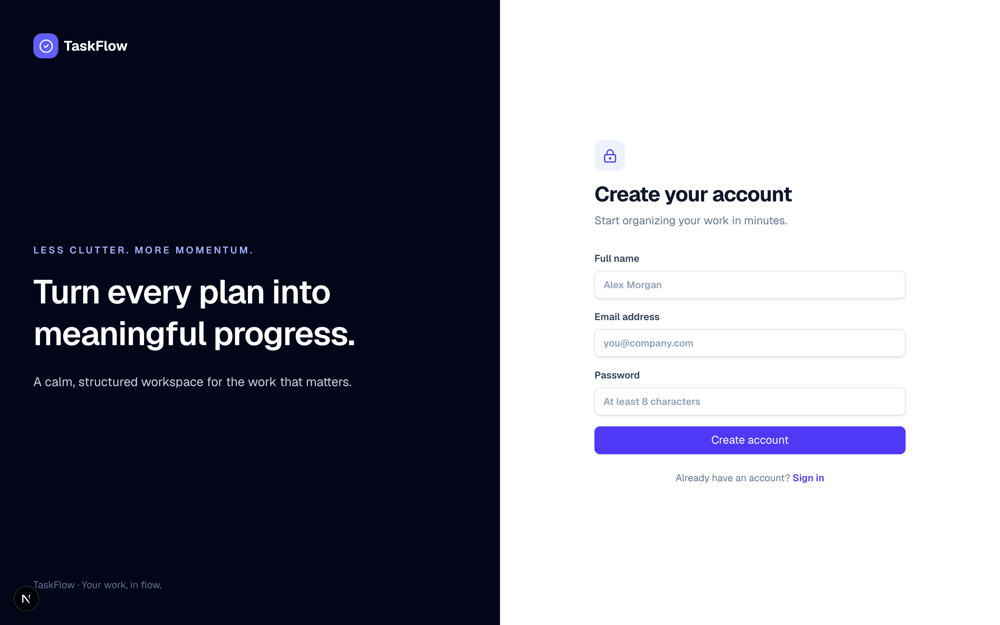
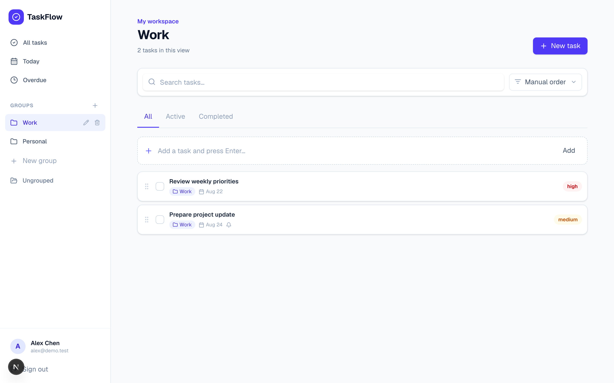
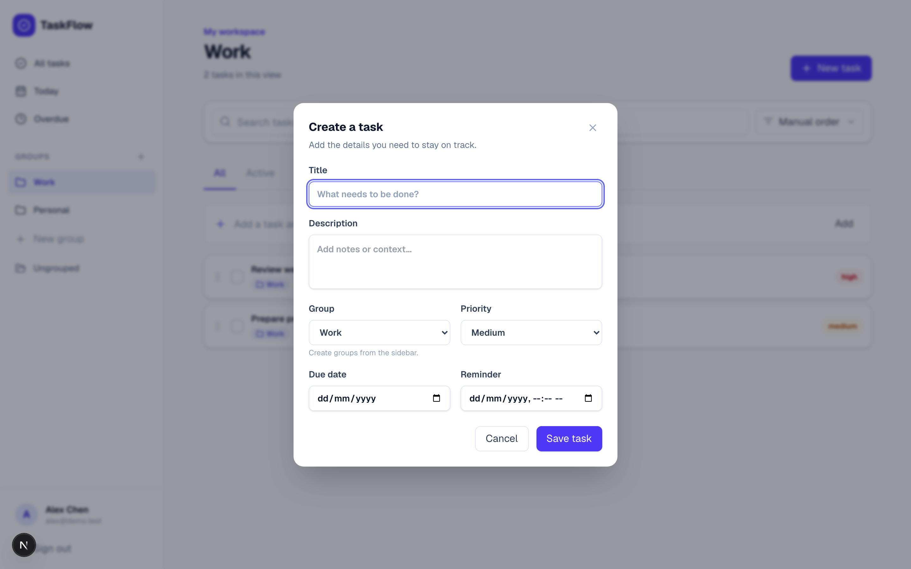
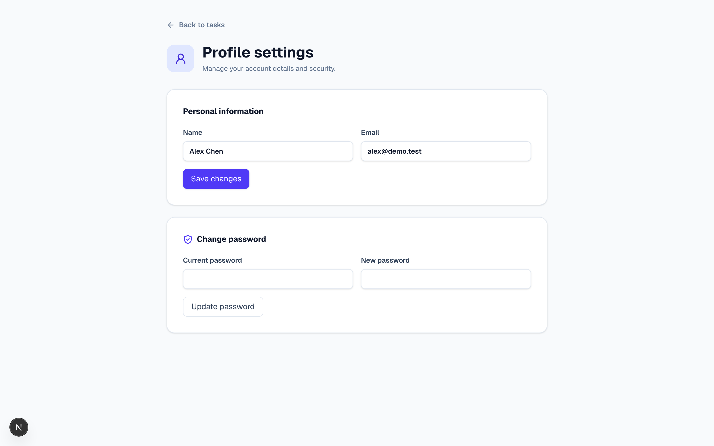
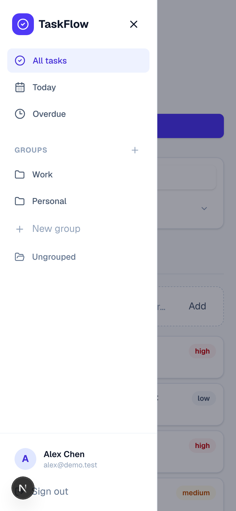
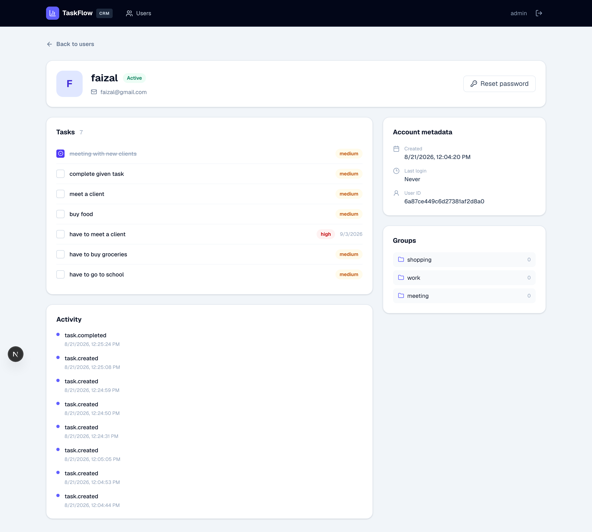

# TaskFlow

A simple task manager with JWT cookie auth, MongoDB, and a separate admin CRM.

- Web: [http://localhost:3000](http://localhost:3000)
- CRM: [http://localhost:3000/crm](http://localhost:3000/crm)
- API: [http://localhost:4000/api](http://localhost:4000/api)

This is the first MVP. Users register, log in, and manage their own tasks. Admins use a different login for CRM.

---

## Run locally

You need **Node.js 20+**. pnpm comes through Corepack.

```bash
corepack enable
pnpm install

cp apps/api/.env.example apps/api/.env
cp apps/web/.env.example apps/web/.env.local
```

Start MongoDB. Pick one:

```bash
# if Docker is installed
docker compose up -d mongo

# if Docker is not installed
pnpm --filter @taskflow/api mongo:local
```

Then seed demo data and start both apps:

```bash
pnpm seed
pnpm dev
```

Open [http://localhost:3000](http://localhost:3000).

### Demo logins

Created by `pnpm seed`. Local development only.

| Role | Login | Password |
| --- | --- | --- |
| User | `alex@demo.test` | `Demo@12345` |
| User | `sam@demo.test` | `Demo@12345` |
| Empty account | `riya@demo.test` | `Demo@12345` |
| CRM admin | `admin` | `Admin@12345` |

Change these before any public deploy. Do not commit `.env` files.

### Useful commands

```bash
pnpm dev          # web + API
pnpm test         # unit tests
pnpm build
pnpm lint
pnpm typecheck
pnpm seed
```

---

## What you can do

**User app**

- Register, log in, log out
- Create, edit, delete, complete tasks
- Priority, due date, reminder
- Groups in the sidebar
- Add / remove a task from a group
- Search, sort, drag-and-drop order
- Filters: All / Active / Completed, Today, Overdue
- Profile

**CRM** (`/crm`)

- Admin login only (no admin registration)
- List, search, create, edit users
- Enable / disable / delete users
- Reset a password
- See a user’s tasks, groups, and activity

Each user only sees their own tasks. CRM uses a separate admin cookie.

---

## Screenshots

All images below were taken from the running local app.

### Sign in


### Create an account



### Task workspace


### Group view



### New / edit task



### Profile



### Phone layout




### CRM sign in


### CRM users


### CRM user detail



---

## Tests

```bash
pnpm test
```

| Suite | Tool | Result |
| --- | --- | --- |
| API | Jest | **12 / 12 passed** |
| Web | Vitest | **10 / 10 passed** |
| **Total** | | **22 / 22 passed** |

API tests cover serialization, ID helpers, and health. Web tests cover the API client, Button, and Badge.


---

## Stack

| Layer | Choice |
| --- | --- |
| Monorepo | pnpm + Turborepo |
| Frontend | Next.js 16, React 19, Tailwind CSS 4 |
| Backend | NestJS 11 |
| Database | MongoDB + Mongoose |
| Auth | JWT in an HttpOnly cookie, bcryptjs |

```
apps/web     Next.js user app + CRM
apps/api     NestJS API
docs         product notes + screenshots
```

---

## Upcoming

This is the starting MVP. Later work:

- Split large screens into reusable components
- Stronger unit + API integration tests
- Playwright end-to-end flows
- GitHub Actions CI
- Better mobile table layout in CRM
- Optional email reminders
- Deploy the web app on Vercel and the API on a small Node host, with MongoDB Atlas

---

## License

Private project for [iamfaizalmunna](https://github.com/iamfaizalmunna).
