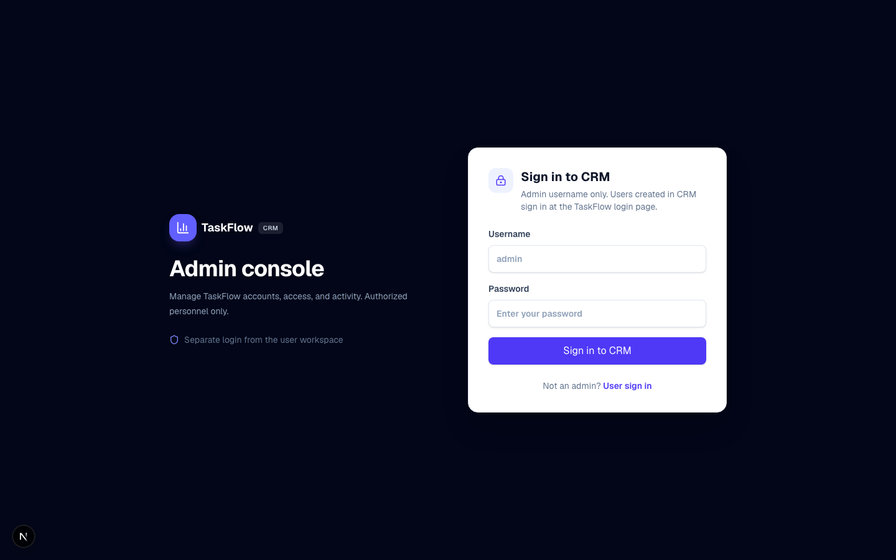
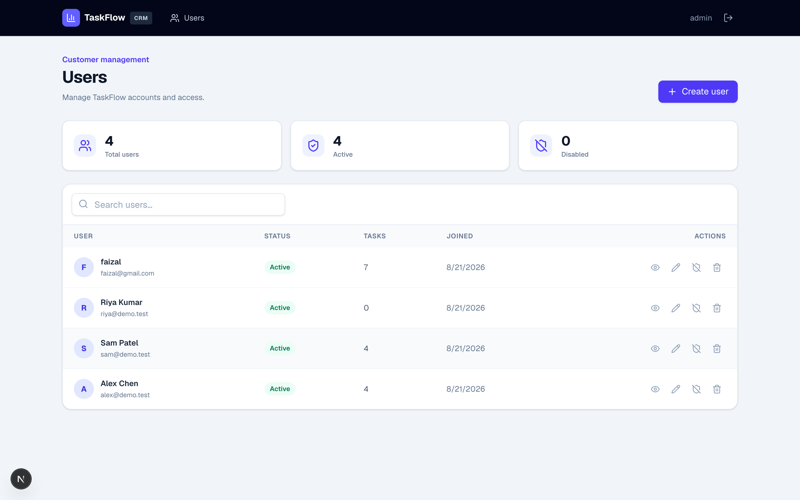
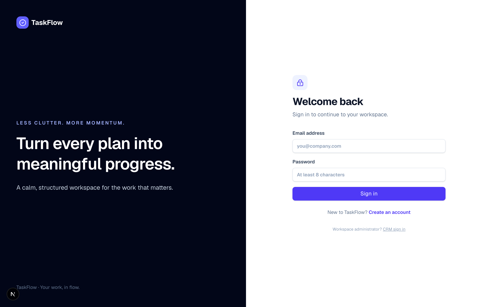
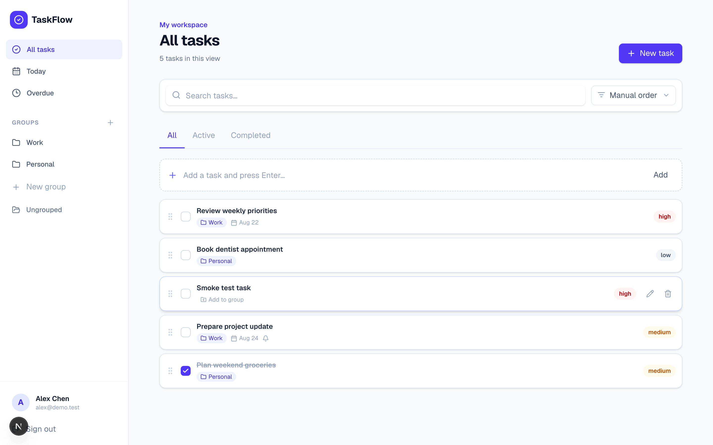
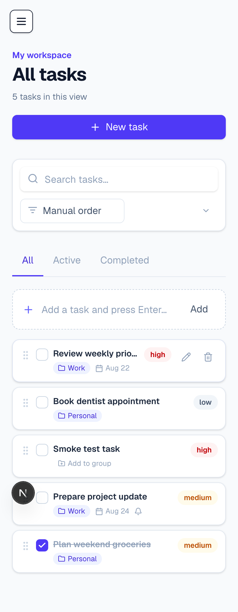
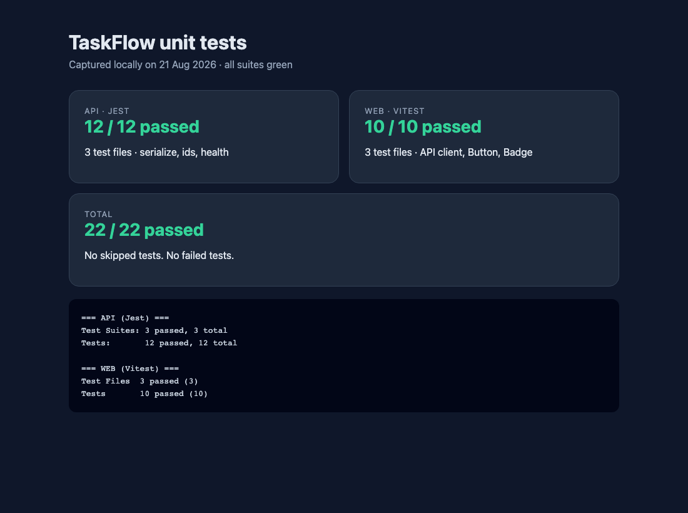

# TaskFlow

Manual task manager with a separate admin CRM. No AI in the product.

| | URL |
| --- | --- |
| App | http://localhost:3000 |
| CRM | http://localhost:3000/crm |
| API | http://localhost:4000/api |

Product spec: [docs/TaskFlow-MVP-Product-Document.pdf](docs/TaskFlow-MVP-Product-Document.pdf)

---

## Run locally

Needs Node.js 20+.

```bash
corepack enable
pnpm install
cp apps/api/.env.example apps/api/.env
cp apps/web/.env.example apps/web/.env.local
```

MongoDB — pick one:

```bash
docker compose up -d mongo
# or, without Docker:
pnpm --filter @taskflow/api mongo:local
```

```bash
pnpm seed
pnpm dev
```

Then open http://localhost:3000.

```bash
pnpm test
pnpm build
```

Do not commit `.env` files.

---

## Test accounts

From `pnpm seed`. Local only.

| App | Login | Password |
| --- | --- | --- |
| User · `/login` | `alex@demo.test` | `Demo@12345` |
| User | `sam@demo.test` | `Demo@12345` |
| User (empty) | `riya@demo.test` | `Demo@12345` |
| CRM · `/crm/login` | `admin` | `Admin@12345` |

Users created in CRM also sign in at **`/login` with their email**, not at `/crm/login`. CRM is admin-only.

---

## Auth

JWT in an **HttpOnly cookie** (not localStorage).

| Who | Cookie | Lifetime |
| --- | --- | --- |
| User | `taskflow_token` | 7 days |
| Admin | `taskflow_admin_token` | 12 hours |

---

## What ships

**App** — register / login / logout, tasks (CRUD, complete, priority, due date, reminder), groups, search, sort, drag-and-drop, profile.

**CRM** — admin login only. List / create / edit / disable / delete users, reset password, inspect tasks, groups, activity.

Each user only sees their own tasks.

---

## Screenshots

### CRM





### App







More: `docs/screenshots/`.

---

## Tests

`pnpm test` — **22 / 22 passed** (API Jest 12, web Vitest 10).



---

## Repo

```
apps/web    Next.js 16 · React 19 · Tailwind 4
apps/api    NestJS 11 · MongoDB / Mongoose · JWT
docs        product PDF + screenshots
```

---

## Later

Component split, API integration tests, Playwright, CI, deploy (Vercel + Atlas).
